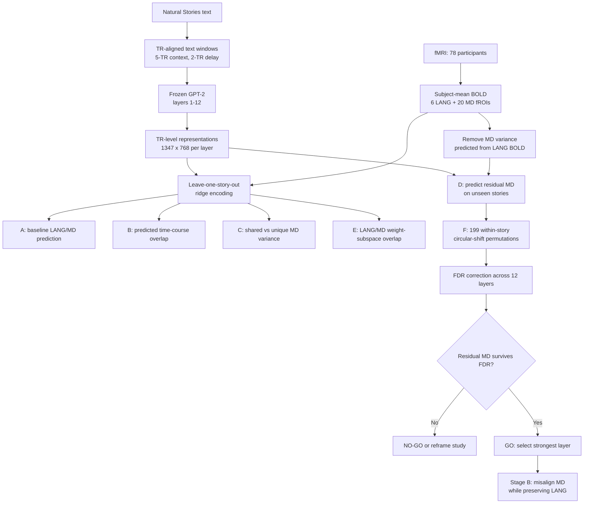

# Region-specific brain (mis)alignment — POC

**Narratives surface-vertex track:** see [NARRATIVES_STAGE_A.md](NARRATIVES_STAGE_A.md).
Its separate engine is software-tested but has no real primary gate result yet.
The numbered workflow and confirmed results below concern Natural Stories
fROIs, not the Narratives vertex-wise experiment.

Code to test **Idea 1**: *misalign an LLM with the multiple-demand (MD) network while
preserving alignment with the language (LANG) network, then measure the effect on
linguistic competence*. Extends Merlin & Toneva, *When Language Models Lose Their Mind*
(ICLR 2026) from a single whole-brain adversarial head to **two network-specific heads**.

The pipeline is deliberately split into a cheap **GO/NO-GO gate (no training)** that
addresses the central feasibility question — *"can one region be misaligned while
preserving the other?"* — and a **training stage** that runs only if the gate passes.

## Workflow and tested hypothesis

**Hypothesis:** GPT-2 contains text-derived information that predicts MD-network
activity beyond what is explained by LANG-network activity, making selective MD
misalignment feasible.



### Confirmed GPT-2 gate result

The 199-permutation profile found significant residual-MD prediction in all 12
layers after Benjamini-Hochberg FDR correction. Layer 9 was strongest:

| Metric | Layer 9 |
|---|---:|
| LANG encoding correlation | 0.134 |
| Raw MD encoding correlation | 0.099 |
| Residual MD correlation | 0.078 |
| Raw MD alignment retained after LANG removal | 79.4% |
| Permutation p-value | 0.005 |
| FDR-adjusted q-value | 0.010 |

This passes the POC gate: GPT-2 layer 9 contains MD-predictive information not
explained solely by LANG activity. It supports proceeding to the intervention stage,
but does not establish causality or show that GPT-2 performs the same computation as
the human MD network. Full layerwise outputs are included under
`results/gpt2_layer_profile_confirm/`.

---

## 0. Data you need (all public)

| What | Where | Why |
|---|---|---|
| fMRI, Natural Stories, **78 participants**, fROI-averaged BOLD for **6 LANG + 10 MD (bilateral) fROIs** localised per participant | OSF `eyp8q` (Shain, Blank, van Schijndel, Schuler & Fedorenko 2020, *Neuropsychologia*, 3.9 GB, has `README.md`) — same cohort also in OSF `ah429` (Shain et al. 2022, *J Neurosci*, 6 GB) | Only public naturalistic dataset found with **both** a language localizer and an MD localizer on the same subjects |
| Story text + word onset times | `github.com/languageMIT/naturalstories` (`words.tsv`, `audio/`) | Build text windows per TR (the OSF CDR stimulus tables usually already include word onsets, in which case this is a fallback) |
| Base LMs | `gpt2` (open), `meta-llama/Llama-3.2-1B` (licence), `bert-base-cased` | Same three families as the anchor paper |
| BLiMP | HF `datasets` (`blimp`) | Fast linguistic-competence proxy; Holmes (200+ tasks) via `github.com/UKPLab/holmes` afterwards |

**Caveats to verify on day 1** (could not be checked remotely):
* The OSF archive is **fROI-averaged** (CDR format), not voxel-level. That is fine for this POC
  (26 response channels, 78 subjects → high-SNR subject-mean, split-half noise ceiling), but it
  means "voxels in language ROIs with NC>0.05" from the anchor paper becomes "fROIs".
* Exact column names differ between releases → run `01_prepare_data.py --inspect` first.
  The loader auto-detects `word/time/docid`, `BOLD/fROI/subject/time`, and `network`
  columns and prints what it found. If fROI→network cannot be inferred, pass `--froi_map`.
* MD fROIs in these releases were localised with the *nonwords > sentences* contrast
  (validated against hard>easy spatial WM in ~80% of participants). Report this.
* **Framing**: the Fedorenko lab's own recent work suggests formal *logical* reasoning may
  recruit regions outside both networks; label MD as "domain-general executive /
  working-memory network" rather than "formal reasoning" unless you verify otherwise.

```bash
bash 00_download.sh                              # deps, OSF, Natural Stories, gpt2
python 01_prepare_data.py --inspect --data_dir data/osf_eyp8q
python 01_prepare_data.py --data_dir data/osf_eyp8q --out data/prepared      # subject-mean
```

---

## 1. Dry-run without any download (5 min, CPU, numpy only)

```bash
python make_synthetic.py --out data/synth_unique --regime unique   # MD has its own signal
python make_synthetic.py --out data/synth_shared --regime shared   # MD = noisy copy of LANG
for r in unique shared; do
  python 01_prepare_data.py --data_dir data/synth_$r/osf --out data/synth_$r/prepared
  python 03_gate_analysis.py --prepared data/synth_$r/prepared \
         --features data/synth_$r/features/layer12.npy --out results/gate_synth_$r.json --n_perm 50
done
```
Expected: `unique` → verdict **GO** (MD residual r≈0.78, p<0.05); `shared` → **NO-GO**
(residual r≈0, p≈1). This is what the real data will be judged against.

---

## 2. Stage A — GO/NO-GO gate on real data (CPU ok; feature extraction wants a GPU)

```bash
python 02_extract_features.py --prepared data/prepared --model gpt2 --layers 6 9 12 --out features/gpt2_base
python 03_gate_analysis.py --prepared data/prepared --features features/gpt2_base/layer9.npy \
       --out results/gate_gpt2_L9.json
```

`03_gate_analysis.py` reports (leave-one-story-out ridge throughout):

| Key | Question it answers |
|---|---|
| **A** encoding r per fROI, raw and / noise-ceiling | Is MD even predictable during passive listening? |
| **B** corr(ŷ_LANG, ŷ_MD) | How much do the two predicted time courses overlap? |
| **C** variance partition (features vs LANG-BOLD → MD) | How much MD variance is *shared* with LANG vs *unique* to the LM features? |
| **D** r on MD **residualised on LANG BOLD** ← **the key number** | Is there MD-predictable information that is *not* LANG information? |
| **E** cos of principal angles between ridge weight subspaces | Do LANG and MD use the same directions of the representation? |
| **F** story-wise circular-shift permutation p for D | Is D above chance? |

### What A-E measure, and why all five are needed

For one GPT-2 layer, each TR has a model representation `X` and observed BOLD
responses for the LANG and MD fROIs. All predictions below are made with
leave-one-story-out ridge regression, so the evaluated story was not used to fit the
encoder.

**A. Baseline encoding: can the representation predict either network?**

Separate ridge outputs predict every LANG and MD fROI from `X`. Pearson correlation
between predicted and observed BOLD is calculated per fROI and averaged by network.
The noise-ceiling-normalised values show how much of the reliably measurable signal is
captured. This is the necessary first check: if MD cannot be predicted at all, there is
no MD alignment to selectively manipulate. A alone is insufficient because successful
MD prediction could be driven entirely by information shared with LANG.

**B. Predicted-time-course overlap: are the two predictions behaving similarly?**

The mean predicted LANG time course is correlated with the mean predicted MD time
course and compared with the corresponding correlation in actual BOLD. High absolute
overlap means the encoders produce strongly coupled network-level trajectories; low
overlap suggests greater temporal separation. This is a descriptive diagnostic, not a
test of unique MD information: correlation can reveal coupling but cannot identify
which representation components or sources of variance are shared.

**C. Variance partitioning: how much MD information is shared versus unique?**

Three cross-validated models predict MD BOLD: GPT-2 features alone, LANG BOLD alone,
and both together. Their R-squared values estimate:

```text
shared MD variance        = R2(features) + R2(LANG) - R2(features + LANG)
unique GPT-2 contribution = R2(features + LANG) - R2(LANG)
```

This asks whether GPT-2 adds predictive power after LANG BOLD is available. It provides
an effect decomposition complementary to D. Cross-validated R-squared can be negative
when predictions generalise poorly, so C is treated cautiously and is not the primary
GO/NO-GO statistic.

**D. Residual MD prediction: is there MD-predictive information beyond LANG?**

First, LANG BOLD predicts MD BOLD using story-wise cross-validation. That prediction is
subtracted from observed MD BOLD, leaving the component not explained by LANG:

```text
MD residual = observed MD - MD predicted from LANG
```

GPT-2 features are then used to predict this residual on unseen stories. A positive
residual correlation means the representation contains text-derived information about
MD responses that is not recoverable from LANG activity alone. This is the key
separability result and the direct justification for attempting to alter MD alignment
while preserving LANG. It does not mean language was removed from the input, nor does
it establish that GPT-2 or the text causes MD activity.

**E. Weight-subspace overlap: do LANG and MD depend on the same GPT-2 directions?**

Ridge weights map the 768-dimensional GPT-2 representation to each network's fROIs.
Principal angles compare the feature subspaces spanned by the LANG and MD weight
matrices. Cosines near 1 indicate shared representation directions; values nearer 0
indicate more distinct directions. E supplies a geometric feasibility check: even when
D is positive, strongly overlapping directions warn that changing MD alignment may
also disturb LANG. It is supportive evidence rather than a significance test.

Together, the analyses prevent an overly strong conclusion from any single metric:
A verifies that a signal exists, B describes network-level coupling, C decomposes
predictive variance, D tests the specific MD component left after accounting for LANG,
and E assesses whether the model directions used by the networks are geometrically
separable. F then tests whether D exceeds an autocorrelation-preserving null.

Decision rule (printed as `verdict`):
* D not significant → **NO-GO** for clean region-specific misalignment. The honest paper
  then becomes *"anatomically dissociable networks are not separable in LM
  representations"* — still publishable, and it directly answers the feasibility question.
* D significant but <30% of raw MD r → **subtle**: use `--orthogonalize --grad_surgery`.
* D ≥30% → **GO**.

Run the gate for ≥2 layers and ≥2 models before deciding (alignment is layer-dependent).

---

## 3. Stage B — interventions (GPU)

```bash
bash run_all.sh gpt2 9 0        # model, feature layer, held-out story
```
or individually:
```bash
python 04_train_region_misalign.py --prepared data/prepared --model gpt2 \
       --condition misalign_md_preserve_lang --heldout_story 0 --out runs/misMD_s0 --lora_targets c_attn,c_proj
```

Loss (anchor paper's weights kept: `w_lm=0.1`, brain weights `10`, LoRA, 5 epochs, bs 16):

```
L = w_lm·L_LM + w_target·L_brain(target_head(GRL(h)), Y_target) + w_preserve·L_brain(preserve_head(h), Y_preserve)
```

| `--condition` | target (GRL ↓) | preserve (↑) | purpose |
|---|---|---|---|
| `misalign_md_preserve_lang` | MD | LANG | **Idea 1** |
| `misalign_lang_preserve_md` | LANG | MD | mirror / double dissociation |
| `misalign_all` | LANG+MD | – | anchor-paper replicate |
| `preserve_control` | MD (permuted) | LANG (permuted) | anchor's "Brain Preserving" control — **the comparison baseline** |
| `brain_tuned_md` | MD, no GRL | LANG | converse: push MD up |
| `lm_only` | – | – | stimulus-tuned control (Merlin, Moussa & Toneva 2026) |

Flags for the shared-features problem: `--orthogonalize` (adversarial target = MD residual
after regressing out LANG BOLD) and `--grad_surgery` (PCGrad: project the GRL gradient off the
preserve gradient when they conflict). Run **≥3 seeds × all 10 held-out stories** for stats.

---

## 4. Stage C — evaluation

```bash
# alignment per network from an INDEPENDENT ridge encoder on held-out story (never the training heads)
python 05_eval_alignment.py --prepared data/prepared --heldout_story 0 \
   --features base=... ctrl=... misMD=... misLANG=... misALL=... --out results/align_s0.json
# linguistic competence: BLiMP (12 phenomena) + held-out story perplexity
python 06_eval_linguistic.py --model gpt2 --adapter runs/misMD_s0/adapter --prepared data/prepared \
   --heldout_story 0 --max_per_task 300 --out results/ling_misMD_s0.json
```

**Success criteria for Idea 1** (vs `preserve_control`, bootstrap CIs in `vs_control`):
1. `delta_md` < 0 and CI excludes 0 (MD alignment fell);
2. `delta_lang` CI includes 0 (LANG preserved) → `selectivity_misMD` > 0;
3. held-out perplexity unchanged (`train_log.json`, `06` output);
4. *then* look at BLiMP per-phenomenon deltas (and Holmes for the paper).

Report both directions (misMD vs misLANG) — a double dissociation is the strongest result.

---

## File map
```
00_download.sh           data + deps
01_prepare_data.py       OSF CDR tables -> TR-aligned dataset (text window, 26 fROIs, noise ceiling)
02_extract_features.py   frozen or LoRA-adapted LM features per TR window
03_gate_analysis.py      GO/NO-GO gate (numpy only)
04_train_region_misalign.py  two-head GRL fine-tuning, all conditions
05_eval_alignment.py     independent ridge re-evaluation per network
06_eval_linguistic.py    BLiMP + perplexity (Holmes pointer)
make_synthetic.py        fake data in the expected layout; GO vs NO-GO regimes
run_all.sh               one model, one held-out story, end-to-end
common.py                ridge CV, lags, Pearson, GRL, dataset container
```

## References
Merlin & Toneva 2026 (ICLR) arXiv:2603.23091 · Shain et al. 2020 *Neuropsychologia* 138:107307 (OSF eyp8q) ·
Shain et al. 2022 *J Neurosci* 42(39):7412 (OSF ah429) · Futrell et al. 2021 *LRE* (Natural Stories) ·
Blank, Kanwisher & Fedorenko 2014 *J Neurophysiol* (LANG/MD dissociation) · Warstadt et al. 2020 *TACL* (BLiMP) ·
Waldis et al. 2024 *TACL* (Holmes) · Ganin et al. 2016 *JMLR* (gradient reversal) · Yu et al. 2020 (PCGrad).
